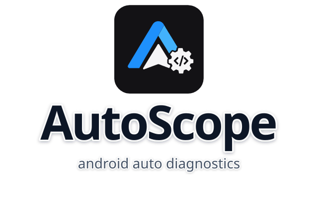

<p align="center">
  
</p>

# AutoScope

Android Auto diagnostics. AutoScope runs on the car screen through Android Auto and shows what the host, the screen, the touch layer and the car hardware report. A phone screen shows the same live report and saves it as JSON and text.

It is a developer tool for personal use, installed outside Google Play. Everything stays on the device: there is no network permission and no analytics.

## Status

Built with `./gradlew assembleDebug`, with JVM unit tests for the data layer and the phone models. An earlier build ran on the Desktop Head Unit (DHU): the four tabs, the touch tester and the Visual dashboard opened. Later changes (dark Visual surface, shorter rows, car drawing, "Refresh values") are not rechecked there, and nothing has run in a real car. See [KNOWN_LIMITATIONS.md](KNOWN_LIMITATIONS.md) and [SPIKE.md](SPIKE.md).

## Install

Download `AutoScope-1.0.0.apk` from the [latest release](https://github.com/jantursky/AutoScope/releases/latest) and open it on the phone, or run `adb install AutoScope-1.0.0.apk`. Then follow [Setup](#setup) for developer mode and "Unknown sources". F-Droid is planned; the store metadata is in `fastlane/`.

## What is in the car

**Real cars and sideloading:** a real Android Auto host refuses a Car App Library app that was not installed from Google Play, even with "Unknown sources" on. Installed from the APK, AutoScope shows up as a media app with phone side data (Overview, Network, Permissions, Log, Mark this moment). The template UI below runs on the DHU, and in a car only if the app comes from Play. Details in [KNOWN_LIMITATIONS.md](KNOWN_LIMITATIONS.md).

Car UI uses `androidx.car.app` 1.7.0 templates only, category **POI**. The library allows four tabs, so the fourth one is a menu:

| Tab | Content |
| --- | --- |
| Overview | "Diagnostic tool" marker, Car App API level, **Mark this moment**, connection, host, phone, performance |
| Screen | Screen size, density, dark mode, locale, plus the template constraints |
| Hardware | Car info and sensors, a "Grant permissions" row |
| More | Touch, Visual, Sensors, Network, Permissions, Log |

The rows behind More:

- **Touch** opens a map screen with a drawing surface: crosshair, trail of the last 10 events, counters, events per second. If no surface arrives, a tap latency test takes over.
- **Visual** draws a compass, a g-force dot and a speed gauge on the map surface. It follows the car's dark mode.
- **Sensors**, **Network**, **Permissions** and **Log** are plain lists.

On hosts below Car App API level 6 a list menu replaces the tabs. Lists refresh on a timer (default 1 s, 0.5 to 10 s, set on the phone) and only when a stable value changed. Values that change all the time, like speed or memory, update when you pick "Refresh values", so the list never jumps back to the top.

## What is on the phone

The phone app shows the same live report in plain Views, with a light, dark or system theme. The header holds the connection state and a three dot menu (refresh interval, theme, save, copy report). Tabs:

- **Car**: a verdict card (Ready, Partly working, No car session), a top-down car that shows only values the car reported, a Wi-Fi quality chip, the connection timeline.
- **One tab per group**: connection, host and library, screen (with a to-scale drawing of the display, its diagonals and, when reported, the visible and stable areas), template constraints, hardware, permissions, touch, performance, lifecycle, phone. A badge counts fields with a problem.
- **Changes**: what differs from the last saved report.
- **Reports**: saved reports. Tap to share, long press to delete, or delete all.
- **Help**: setup steps.

## Setup

### One command

```sh
scripts/dev.sh
```

Or double click `scripts/AutoScope-DHU.command`. The script checks the tools, installs the DHU and an emulator image if they are missing, builds and installs the app, grants the car permissions, resets Android Auto and the port forward, and starts the DHU. It retries until the phone answers. One step stays manual because Android Auto does not let other apps do it: on the phone open Android Auto, three dot menu, **Start head unit server**. Do that before each DHU run.

`scripts/dev.sh --no-build` installs the last built APK. Screenshots: type `screenshot name.png` in the DHU terminal; files land in `dhu-screenshots/`.

### By hand

1. **Developer mode in Android Auto.** Phone Settings > Apps > Android Auto > Additional settings in the app. Scroll to the version line and tap it about 10 times, then confirm.
2. **Unknown sources.** Three dot menu > Developer settings > "Unknown sources". The app launched on the DHU with it on and off; a real car may behave differently.
3. **Install.** `./gradlew assembleDebug`, then `adb install -r app/build/outputs/apk/debug/app-debug.apk`.
4. **Permissions.** See below.
5. **DHU.** `scripts/setup-dhu.sh` once, then start "Start head unit server" on the phone and run the DHU.

### Permissions

Speed, fuel, mileage and location need runtime permissions. Either:

- open **Hardware** in the car and pick **Grant permissions**; the dialog appears on the phone and only while the car is parked, or
- run `adb shell pm grant com.jantursky.autoscope <permission>` for `com.google.android.gms.permission.CAR_SPEED`, `CAR_FUEL`, `CAR_MILEAGE` and `android.permission.ACCESS_FINE_LOCATION`.

The Permissions view in the car and the Permissions tab on the phone list what is granted.

### Real car

Connect the phone, enable developer mode and "Unknown sources" as above, and look for AutoScope in the car's app launcher. If it does not show up, check the launcher customisation in Android Auto settings. Wired and wireless projection both work in principle; the Wi-Fi fields on the phone matter most for wireless.

## Reports

"Mark this moment" in the car and Save in the phone menu write `autoscope-<time>-<reason>.json` and `.txt` to the app's files directory. A report is also saved on every connection state change. "Copy report" puts the text version on the clipboard. The Reports tab shares files with `ACTION_SEND_MULTIPLE` and deletes them.

## Fields

Every field carries a value, a source and a status: OK, UNAVAILABLE (with a reason), PERMISSION_MISSING or NOT_SUPPORTED_BY_HOST. The DHU column is the Android Auto version the field was seen on in the Desktop Head Unit; **not tested** means compiled and unit tested only. The Mazda CX-5 column is filled in after a drive.

| Field | API | Permission | DHU | Mazda CX-5 |
| --- | --- | --- | --- | --- |
| Connection type, time connected, reconnects | `CarConnection.getType` | none | 18.0.664264 (DHU, projection) | to test |
| Car App API level | `CarContext.getCarAppApiLevel` | none | 18.0.664264 (spike, level 8) | to test |
| Host package, uid | `CarContext.getHostInfo` | none | not tested | to test |
| Car App Library version | `R.string.car_app_library_version` (not public API) | none | not tested | to test |
| Android Auto version name, code | `PackageManager.getPackageInfo` | `<queries>` entry (API 30+) | not tested | to test |
| Phone Android, SDK, manufacturer, model | `Build` | none | not tested | to test |
| Screen width, height, dpi, density, scaled density, dp sizes, smallest width, aspect ratio, orientation | `CarContext` resources, `DisplayMetrics`, `Configuration` | none | 18.0.664264 (DHU, 800 x 400 px) | to test |
| Refresh rate | `Display.getRefreshRate` (library virtual display, Android 11+) | none | not tested | to test |
| Visible and stable area | `SurfaceCallback.onVisibleAreaChanged`, `onStableAreaChanged` | `androidx.car.app.ACCESS_SURFACE` | DHU did not report them | to test |
| Dark mode, UI mode night, font scale, locale | `CarContext.isDarkMode`, `Configuration` | none | not tested | to test |
| List, grid, pane, place list, route list limits | `ConstraintManager.getContentLimit` | none | not tested | to test |
| App driven refresh | `ConstraintManager.isAppDrivenRefreshEnabled` (API 6) | none | not tested | to test |
| Template step limit, refresh limit | documented values, not measured | none | n/a | n/a |
| Make, model, year | `CarInfo.fetchModel` | none on Android Auto | not tested | to test |
| EV connector types, fuel types | `CarInfo.fetchEnergyProfile` | `com.google.android.gms.permission.CAR_FUEL` | not tested | to test |
| Speed (raw, display) | `CarInfo.addSpeedListener` | `com.google.android.gms.permission.CAR_SPEED` | not tested | to test |
| Odometer | `CarInfo.addMileageListener` | `com.google.android.gms.permission.CAR_MILEAGE` | not tested | to test |
| Battery level, fuel level, range | `CarInfo.addEnergyLevelListener` | `com.google.android.gms.permission.CAR_FUEL` | not tested | to test |
| Toll card | `CarInfo.addTollListener` | none | not tested | to test |
| EV charge port | `CarInfo.addEvStatusListener` (experimental) | none documented | not tested | to test |
| Accelerometer, gyroscope, compass | `CarSensors` | none documented | not tested (the DHU feeds none) | to test |
| Car location | `CarSensors.addCarHardwareLocationListener` | `android.permission.ACCESS_FINE_LOCATION` | not tested | to test |
| Touch events, counters, events per second | `SurfaceCallback` via `AppManager.setSurfaceCallback`, `MapWithContentTemplate` | `ACCESS_SURFACE`, `MAP_TEMPLATES` | not tested | to test |
| Tap latency | `Screen.invalidate` to `onGetTemplate` | none | not tested | to test |
| Session to first template, invalidate to template, templates per minute | `Session`, `Screen` timing | none | not tested | to test |
| Java heap, native heap, process PSS | `Runtime`, `Debug` | none | not tested | to test |
| Granted and missing permissions | `checkSelfPermission` | none | n/a (phone) | n/a |
| Lifecycle log | `Session`, `Screen` lifecycle, `onCarConfigurationChanged` | none | not tested | to test |
| Battery state, percent, temperature | `ACTION_BATTERY_CHANGED` | none | n/a (phone) | n/a |
| Thermal status | `PowerManager.getCurrentThermalStatus` (API 29+) | none | n/a (phone) | n/a |
| Power save mode | `PowerManager.isPowerSaveMode` | none | n/a (phone) | n/a |
| Bluetooth state | `BluetoothAdapter.getState` | none declared | n/a (phone) | n/a |
| Wi-Fi state, band, link speed | `WifiManager`, `WifiInfo` | `ACCESS_WIFI_STATE`, `ACCESS_NETWORK_STATE` | n/a (phone) | n/a |
| Free memory, low memory | `ActivityManager.getMemoryInfo` | none | n/a (phone) | n/a |

## Layout

```
core/      pure Kotlin data layer: Field, Status, DiagnosticsRepository, report formats, ReportStore
app/       Android app: car side (car/), phone side (phone/), wiring (AppContainer)
spikes/    Step 0 feasibility spikes: car app (IOT, POI) and media app
scripts/   dev.sh (one command), DHU setup, spike install
.github/   CI workflow, logo
```

<!-- PROJECTS:START -->
## Other Projects & Products

<table align="center">
  <tr>
    <td align="center" valign="top" width="33%">
      <a href="https://github.com/jantursky/" target="_blank" rel="noopener noreferrer">
        <picture>
          <source media="(prefers-color-scheme: dark)" srcset="https://apptiary.com/projects/icons/github-dark.svg">
          
        </picture>
        <br><b>GitHub Profile</b>
      </a>
      <br><sub>Open-source repositories &amp; code</sub>
    </td>
    <td align="center" valign="top" width="33%">
      <a href="https://podcasttotranscript.com/?utm_source=AutoScope&amp;utm_medium=readme&amp;utm_campaign=other-projects&amp;utm_content=podcast-to-transcript" target="_blank" rel="noopener noreferrer">
        <picture>
          <source media="(prefers-color-scheme: dark)" srcset="https://apptiary.com/projects/icons/podcasttotranscript-dark.svg">
          
        </picture>
        <br><b>Podcast To Transcript</b>
      </a>
      <br><sub>Podcast transcripts, summaries &amp; chapters</sub>
    </td>
    <td align="center" valign="top" width="33%">
      <a href="https://loupekit.com/?utm_source=AutoScope&amp;utm_medium=readme&amp;utm_campaign=other-projects&amp;utm_content=loupekit" target="_blank" rel="noopener noreferrer">
        <picture>
          <source media="(prefers-color-scheme: dark)" srcset="https://apptiary.com/projects/icons/loupekit-light.svg">
          
        </picture>
        <br><b>LoupeKit</b>
      </a>
      <br><sub>Tech stack, design tokens, AI code checker</sub>
    </td>
  </tr>
  <tr>
    <td align="center" valign="top" width="33%">
      <a href="https://textarray.com/?utm_source=AutoScope&amp;utm_medium=readme&amp;utm_campaign=other-projects&amp;utm_content=textarray" target="_blank" rel="noopener noreferrer">
        <picture>
          <source media="(prefers-color-scheme: dark)" srcset="https://apptiary.com/projects/icons/textarray-light.svg">
          
        </picture>
        <br><b>TextArray</b>
      </a>
      <br><sub>Online text transformation tool</sub>
    </td>
    <td align="center" valign="top" width="33%">
      <a href="https://addonhive.com/?utm_source=AutoScope&amp;utm_medium=readme&amp;utm_campaign=other-projects&amp;utm_content=addonhive" target="_blank" rel="noopener noreferrer">
        <picture>
          <source media="(prefers-color-scheme: dark)" srcset="https://apptiary.com/projects/icons/addonhive-dark-v3.svg">
          
        </picture>
        <br><b>AddonHive</b>
      </a>
      <br><sub>Addons &amp; integrations hub</sub>
    </td>
    <td align="center" valign="top" width="33%">
      <a href="https://apptiary.com/mobile/games/?utm_source=AutoScope&amp;utm_medium=readme&amp;utm_campaign=other-projects&amp;utm_content=mobile-games-and-apps" target="_blank" rel="noopener noreferrer">
        <picture>
          <source media="(prefers-color-scheme: dark)" srcset="https://apptiary.com/projects/icons/stores-dark-v2.svg">
          
        </picture>
        <br><b>Mobile Games &amp; Apps</b>
      </a>
      <br><sub>Android &amp; iOS Applications</sub>
    </td>
  </tr>
  <tr>
    <td align="center" valign="top" width="33%">
      <a href="https://jantursky.com/?utm_source=AutoScope&amp;utm_medium=readme&amp;utm_campaign=other-projects&amp;utm_content=and-more" target="_blank" rel="noopener noreferrer">
        <picture>
          <source media="(prefers-color-scheme: dark)" srcset="https://apptiary.com/projects/icons/more-dark.svg">
          
        </picture>
        <br><b>And more</b>
      </a>
      <br><sub>More projects, writing &amp; contact</sub>
    </td>
  </tr>
</table>
<!-- PROJECTS:END -->

## License

MIT
